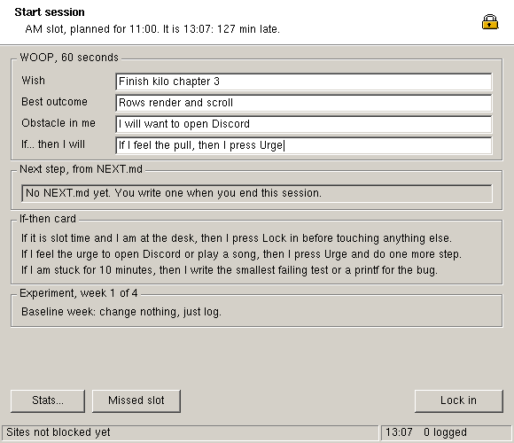

# lockin

A small Linux program that blocks music, Discord and AI sites until you shut
down, then walks you through one focus session: a 60-second WOOP, your
if-then card, a 10-minute commitment, and a logged ending with `NEXT.md`.
It is written in C17 with its own Windows 2000-style toolkit and one
dependency, libX11.



## Quick start

```sh
sudo apt install build-essential libx11-dev
make build
sudo ./build/release/lockin
```

Press **Lock in**. From then until the next reboot the blocked sites do not
resolve, Discord and Spotify are closed whenever they start, and the window
ignores its close button, Ctrl-C and `kill`. Run it without `sudo` (`make
dev`) to look around: everything works except the lock.

To install it as `lockin`: `sudo make install`.

## Requirements

| Need | Version | For |
|---|---|---|
| Linux with X11 or XWayland | kernel 3.8+ | the hosts-file mount, the window |
| gcc or clang | gcc 11+, clang 14+ (built with gcc 13.3) | C17 |
| GNU make | 4.x | building |
| libX11 headers | 1.8.x (use a distro build patched past 1.8.13) | the window |

`make doctor` checks these and the test tools and prints the fix for each
missing one.

## Commands

| Command | Does |
|---|---|
| `make build` | Builds `build/release/lockin` |
| `make dev` | Runs it without root; the window opens, blocking is off |
| `make test` | Unit tests under AddressSanitizer and UBSan, three runs |
| `make test-e2e` | Real-system and real-window tests; asks for sudo |
| `make coverage` | Every test on an instrumented build; fails under 95% |
| `make lint` | clang-tidy, cppcheck, shellcheck |
| `make size` | Function and file size limits |
| `make scan` | gitleaks and semgrep |
| `make fmt` | Formats the code |
| `make docs` | Regenerates the embedded font |
| `make check` | All of the above |
| `make doctor` | Checks your tools |
| `make install` / `uninstall` | Copies to or removes from `/usr/local/bin` |
| `make clean` | Deletes `build/` |

The tests that need root run inside `unshare -m`, a private mount namespace.
They never touch your real `/etc/hosts`.

## Project layout

| Folder | Holds |
|---|---|
| `src/core` | Pure logic: slots, the log row, statistics, settings, the block list. No OS calls |
| `src/ui` | The toolkit: a software canvas, a bitmap font, the controls |
| `src/platform` | `platform.h` and the X11 window. A port adds one file here |
| `src/sys` | `sys.h` and the Linux files, clock, block and crash trace. A port adds files here |
| `src/app` | The screens, the button actions, the files lockin keeps, `main` |
| `tests` | Unit tests, a fake system, the root-level system tests, the X11 end-to-end script |
| `tools` | The font generator |
| `scripts` | `doctor`, the size gate, the scans |
| `docs` | Screenshots and decision records |

## Configuration

Settings live in `~/.config/lockin/lockin.conf`, written with comments on
first run. Check your edits with `lockin --check`; it lists every problem
with its line number and prints the hosts that would be blocked.

| Setting | Default | Meaning |
|---|---|---|
| `slot_am` | `11:00` | Morning start time |
| `slot_pm` | `23:00` | Evening start time |
| `hard_stop` | `02:00` | When the header starts telling you to sleep |
| `commit_minutes` | `10` | Length of the opening commitment, 1 to 120 |
| `project` | empty | Folder that holds `NEXT.md`; empty keeps it with the log |
| `scale` | `0` | Window zoom 1 to 3; 0 picks from the screen height |
| `plan` | three built-in lines | Your if-then card; up to 3 lines replace the built-ins |
| `block` | none | Extra host to block; repeat the line for more (64 max) |
| `allow` | none | Built-in host to leave alone |
| `kill` | none | Extra program to close while locked, by process name |

None is required. Under `sudo` the files belong to you, not root.

| File | Holds |
|---|---|
| `~/.local/share/lockin/sessions.csv` | One row per slot: worked or missed |
| `~/.local/share/lockin/NEXT.md` | Your next step, unless `project` is set |
| `~/.local/state/lockin/state` | Your last WOOP answers and sleep times |
| `~/.local/state/lockin/lockin.log` | Every error, and a stack trace after a crash |

## Tests

```sh
make test        # 109 unit tests, no root
make test-e2e    # system and window tests, sudo
make coverage    # all of them, with the 95% gate
```

`make coverage` prints the totals and writes the per-file table to
`build/cov/coverage.txt`. The last run is in [GATES.md](GATES.md).

## Deploy

There is nothing to deploy: it is one binary. `sudo make install` copies it
to `/usr/local/bin/lockin`. To start it at your slot times, add a line for
each to your desktop's autostart or a systemd user timer; lockin itself only
decides which slot "now" belongs to.

## Troubleshooting

| You see | Cause and fix |
|---|---|
| `Cannot open the X display` | You are not in a desktop session, or sudo dropped `DISPLAY`. Run from a terminal on your desktop; if it persists, `sudo -E lockin` |
| `Not running as root` in the status bar | Started without sudo. Close it and run `sudo lockin` |
| A blocked site still loads | The tab was already open, the browser uses a proxy or VPN, or it is a Flatpak or Snap browser started before the lock. Close the tab; restart the browser once after locking |
| `Cannot put the block list over /etc/hosts` | `/etc/hosts` is missing or you are in a container without mount rights. Nothing was changed |
| The window is tiny on a 4K screen | Set `scale = 2` in `lockin.conf` |

After a crash, the last lines of `~/.local/state/lockin/lockin.log` hold the
signal number and a stack. Turn an address into a file and line with
`addr2line -f -e build/release/lockin 0xADDRESS`.

**Getting out early.** Reboot. That is the design. If you must: `sudo pkill
-9 lockin` ends the window and `sudo umount /etc/hosts` lifts the block.

## Links

[ARCHITECTURE.md](ARCHITECTURE.md) · [USE-CASES.md](USE-CASES.md) ·
[THREATS.md](THREATS.md) · [PERF.md](PERF.md) · [STACK.md](STACK.md) ·
[DECISIONS.md](DECISIONS.md) · [GATES.md](GATES.md) · [docs/adr](docs/adr) ·
[AGENTS.md](AGENTS.md)

The embedded font is the X.Org Adobe Helvetica bitmap; its licence is in
[NOTICE](NOTICE).
